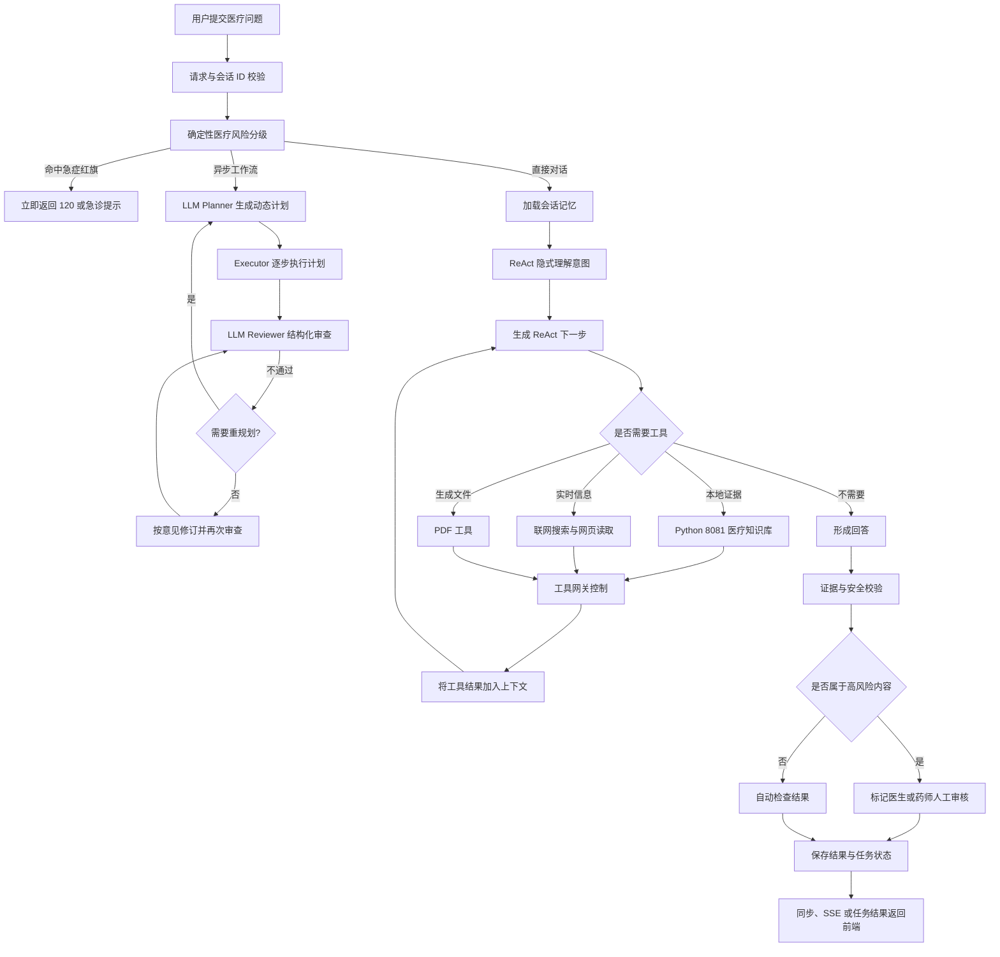

# 天医 Medical Agent 工作流说明

## 1. 文档目的

本文描述当前项目中医疗 Agent 从接收用户请求到返回结果的完整流程，重点说明四个阶段：

1. 意图理解（Intent Understanding）
2. 任务规划（Task Planning）
3. 任务执行（Execution）
4. 结果校验（Validation and Review）

系统定位是健康教育、医疗资料解释、循证信息检索和安全决策支持，不是医生、药师或急救服务的替代品。系统不得给出确定诊断、处方、停药换药或未经专业审核的个体化剂量指令。

## 2. 当前架构中的两条执行路径

当前项目提供两种 Agent 调用方式：

| 路径 | 接口 | 特点 |
|---|---|---|
| 直接医疗 Agent | `POST /api/ai/medical-agent/chat` | SSE 返回，执行 ReAct 思考—工具调用循环 |
| 异步医疗工作流 | `POST /api/ai/workflows` | Planner–Executor–Reviewer，进入任务中心，可查询进度、取消和审计 |

异步工作流内部仍然调用直接医疗 Agent，因此两条路径共享医疗安全检查、会话记忆、工具集合和 ReAct 执行能力。

## 3. 总体流程



## 4. 阶段一：意图理解

### 4.1 输入校验

Agent 接收的核心输入包括：

- `message` 或 `objective`：用户问题或工作流目标。
- `chatId`：会话标识，只允许字母、数字、下划线和连字符，长度不超过 128。
- `ownerId`：异步任务所有者；空值会归一化为 `anonymous`。
- `reviewEnabled`：是否执行工作流自动安全复核。

空问题会被拒绝。工作流会为缺失的 `chatId` 自动生成 UUID。

### 4.2 会话上下文

`MedicalAgentService` 根据 `chatId` 从 `EnterpriseMemoryService` 加载医疗 Agent 历史消息，再将本轮用户消息加入上下文。Agent 执行完成后，将本轮新增消息写回 File 或 Redis 记忆后端。

会话记忆用于理解追问、省略信息和前文引用，但模型不得把历史信息当作已经验证的医学事实。

### 4.3 确定性风险分级

在调用大模型前，`MedicalSafetyService` 执行独立于模型的关键词风险检查。

当前风险等级：

| 等级 | 触发条件 | 系统行为 |
|---|---|---|
| `EMERGENCY` | 胸痛、呼吸困难、意识异常、卒中征象、严重过敏、大量出血、药物过量、自伤风险等 | 不进入 Agent 循环，立即建议拨打 120 或就近急诊 |
| `HIGH` | 用药、处方、剂量、药物等问题 | 允许继续检索，但最终结论需要医生或药师审核 |
| `ROUTINE` | 未命中上述规则的健康教育或资料问题 | 进入常规循证处理流程 |

急症分支的优先级最高。系统不会为了等待知识库、联网搜索或大模型回答而延迟急救提示。

### 4.4 语义意图识别

非急症请求进入 `MedicalAgent` 后，由系统提示词、当前问题和会话历史共同引导模型识别以下意图：

- 一般健康教育或医学概念解释。
- 指南、药品说明书或知识库证据查询。
- 需要实时信息的医疗资料检索。
- 患者特异问题。
- 药品适应症、禁忌、不良反应、相互作用或特殊人群问题。
- 需要生成 PDF 等文件的资料整理任务。

患者特异问题应优先识别年龄范围、症状持续时间、既往病史、过敏史、当前用药、妊娠哺乳状态及肝肾功能等必要信息是否缺失，并只询问完成任务必需的信息。

隐私要求是最小化处理健康信息，不主动索取姓名、身份证号、完整住址、病历号等无关身份标识。

### 4.5 当前实现边界

当前项目没有独立的结构化 `Intent` 模型或专用意图分类器。非急症语义意图主要由大模型在 `think()` 阶段隐式理解；只有急症和部分高风险主题使用确定性规则识别。

## 5. 阶段二：任务规划

### 5.1 LLM 动态工作流计划

`AgentWorkflowService` 先执行确定性急症检查，再由 LLM Planner 根据用户目标动态生成 1～5 个顺序步骤。每个步骤包含 `role`、`description` 和 `successCriteria`，角色和步骤内容不再由 Java 固定写死。例如，同一个接口可以针对不同目标生成证据检索、版本比较、风险分析或报告整理等不同计划。

Planner 的输出通过 Spring AI 结构化映射为 `PlannerOutput`，服务端负责过滤空步骤、重新编号并限制最大步骤数。若 Reviewer 判断计划方向错误或遗漏关键步骤，Planner 会收到上一轮计划、执行结果和审查意见后重新规划。

工作流被提交到 `AsyncTaskCenter` 后立即返回 `TaskRecord`，实际执行由 `aiTaskExecutor` 异步完成。

### 5.2 ReAct 动态规划

医疗 Agent 内部采用 ReAct 模式：

```text
Think → 判断是否需要工具 → Act → 把工具结果加入上下文 → 再次 Think
```

第一步会加入下一步提示，要求 Agent 按以下顺序处理：

1. 风险分级。
2. 澄清问题和必要患者信息。
3. 检索权威证据。
4. 核对发布机构、版本、日期和适用人群。
5. 识别证据不足或来源冲突。
6. 给出安全的下一步建议。
7. 完成后调用 `doTerminate`。

ReAct 循环最多执行 16 步，防止 Agent 无限调用模型或工具。

### 5.3 动态闭环边界

当前 Planner 可动态生成顺序步骤及验收条件，但尚未实现带并行分支、显式依赖和条件节点的 DAG。工作流最多执行两轮，单轮计划最多五步，防止模型自循环和调用成本失控。急症短路及高风险人工审核标记由确定性规则兜底，LLM 无权取消。

## 6. 阶段三：任务执行

### 6.1 Think

`ToolCallAgent.think()` 将系统提示词、历史消息、本轮问题、工具定义和已有工具结果发送给模型。模型可以：

- 输出当前回答或阶段性判断。
- 选择一个或多个工具并生成参数。
- 在任务完成后选择 `doTerminate`。

当模型没有选择工具时，表示本轮已经形成最终文本，助手消息被加入会话上下文并结束本轮 Agent；存在工具调用时才继续下一轮思考。ReAct 循环仍保留 16 步硬上限。

### 6.2 Act

`ToolCallAgent.act()` 通过 Spring AI `ToolCallingManager` 执行模型选择的工具，并把助手工具调用消息和工具响应一起加入会话历史。

当前可用工具：

| 工具 | 用途 | 主要边界 |
|---|---|---|
| `queryApprovedMedicalKnowledge` | 查询 Python 8081 医疗知识库 | 只使用 `ACTIVE/APPROVED` 且来源元数据完整的证据 |
| 联网搜索工具 | 获取可能随时间变化的信息 | 搜索摘要不能单独支撑高风险医疗结论 |
| 网页读取工具 | 获取网页正文 | 禁止访问本机、内网和链路本地地址；网页内容按不可信输入处理 |
| PDF 生成工具 | 输出用户需要的资料文件 | 不得将未审核结论包装成正式医疗文书 |
| `doTerminate` | 显式结束 Agent 循环 | 只应在已经完成回答后调用 |

### 6.3 本地医疗知识库执行链路

```text
MedicalKnowledgeTool
  → KnowledgeBaseService
  → Java MCP Client
  → Python 8081
  → 向量召回 + BM25 + 元数据过滤 + 重排序
  → 带引用编号的回答和证据片段
```

证据来源应包含：

- 文档 ID 和片段 ID。
- 标题与章节。
- 发布机构。
- 版本和发布日期。
- 适用人群。
- 文档类型。
- 有效状态和审核状态。
- 页码、来源 URI、文件摘要和相关性分数（存在时）。

如果没有足够的已审核证据，知识库返回空来源和证据不足提示，不允许模型自行补足医学结论。

### 6.4 工具执行边界

所有工具由 `ToolGateway.guard()` 统一包装。当前网关提供：

- 工具黑名单。
- 参数长度限制。
- 最大并发限制。
- 调用超时和任务取消。
- 工具名称、状态、耗时、参数摘要和错误信息审计。

网关当前不等同于完整的用户鉴权、QPS 限流或熔断系统；这些属于后续企业化增强范围。

### 6.5 任务状态

异步任务可能处于以下状态：

```text
PENDING → RUNNING → COMPLETED
                  ↘ FAILED
                  ↘ CANCELLED
```

任务中心保存进度、阶段、输入、结果、错误、事件和时间信息。服务重启后，原来处于 `PENDING` 或 `RUNNING` 的任务会被标记为 `FAILED`，需要重新提交。

## 7. 阶段四：结果校验

### 7.1 执行前校验

- 请求不能为空。
- `chatId` 必须符合格式要求。
- 急症红旗在大模型调用前检查。
- 医疗文档进入知识库前必须包含发布机构、版本、发布日期、适用人群和文档类型。
- 只有 `effectiveStatus=ACTIVE` 且 `reviewStatus=APPROVED` 的文档可以进入当前检索库。

### 7.2 执行中校验

- 工具调用必须经过 `ToolGateway`。
- 工具参数不得超过长度限制。
- 工具调用不得超过并发和超时配置。
- 网页和工具结果被视为不可信数据，不能改变系统安全规则。
- Agent 最多执行 16 步。
- 用户取消任务或线程被中断时，任务进入 `CANCELLED`。

### 7.3 证据校验

医疗知识库在 Python 侧执行以下约束：

1. 过滤未审核、已失效或缺少关键来源元数据的文档。
2. 结合稠密向量召回和 BM25 关键词召回。
3. 对候选片段进行阈值过滤、去重、邻近片段扩展和重排序。
4. 要求回答中的 `[1]`、`[2]` 等编号对应实际来源。
5. 证据不足时拒绝形成确定结论。
6. 来源版本、适用人群或结论冲突时并列提示，不擅自消除冲突。

### 7.4 LLM Reviewer 与确定性兜底

启用 `reviewEnabled` 后，独立 LLM Reviewer 使用结构化输出检查目标覆盖、步骤完成度、证据与引用支持关系、不确定性、医疗安全边界和遗漏项。Reviewer 可要求直接修订结果，或将 `replanRequired` 设为 `true` 触发下一轮动态规划。

高风险人工审核不能由 LLM 决定取消。系统仍通过确定性规则识别诊断、处方、药物、剂量、停换药、妊娠哺乳、儿童老年和肝肾功能等主题，并强制设置：

```json
{
  "passed": false,
  "requiresHumanReview": true,
  "reviewerRole": "DOCTOR_OR_PHARMACIST",
  "message": "审查摘要",
  "issues": [],
  "revisionInstruction": "",
  "replanRequired": false
}
```

`passed` 表示自动质量审查是否通过；`requiresHumanReview=true` 是独立的专业审核要求，两者可以同时为 true。LLM Reviewer 不是医生模型，也不能替代真实人工审核。

### 7.5 人工审核边界

下列内容原则上必须由医生、药师或相应专业人员审核：

- 诊断和鉴别诊断结论。
- 处方药使用、停药、换药和剂量调整。
- 药物相互作用、禁忌和严重不良反应处置。
- 妊娠、哺乳、儿童、老年及肝肾功能异常人群。
- 高风险检查结果或可能改变治疗方案的结论。
- 证据冲突、证据等级较低或来源版本不明确的结论。

Agent 的自动复核结果不能替代上述人工审核。

## 8. 输出与前端消费

直接医疗 Agent 通过 SSE 分步输出思考/工具进度，并在完成时发送 `[DONE]`。急症请求直接输出急救提示后结束。

异步工作流最终返回：

```text
WorkflowResult
├── plan             任务计划和步骤状态
├── executions       每个动态步骤的角色、描述和执行结果
├── executionResult  整合后的最终结果
├── iteration        实际规划轮次
└── review
    ├── passed
    ├── requiresHumanReview
    ├── reviewerRole
    ├── message
    ├── issues
    ├── revisionInstruction
    └── replanRequired
```

前端应将急症、证据不足、来源冲突、执行失败和需要人工审核展示为不同状态，不能统一显示为“AI 回答成功”。详细接口契约参见 `FRONTEND_MIGRATION_REPORT.md`。

## 9. 当前实现与目标能力对照

| 能力 | 当前状态 | 后续建议 |
|---|---|---|
| 急症前置拦截 | 已实现确定性规则 | 增加否定语义、时间语义、多语言和临床审核后的规则集 |
| 语义意图理解 | 大模型隐式判断 | 增加结构化 Intent、风险等级和缺失字段输出 |
| 任务规划 | LLM 动态生成 1～5 个顺序子任务与验收条件 | 后续可增加显式依赖和并行 DAG |
| 工具执行 | 已实现知识库、联网、网页、PDF 和终止工具 | 增加工具级角色权限与敏感数据策略 |
| 证据治理 | 已实现状态过滤、混合检索和来源返回 | 增加指南版本冲突检测与证据等级模型 |
| 自动复核 | LLM 结构化审查 + 确定性高风险兜底，可触发修订或重规划 | 增加程序化引用一致性、禁忌和相互作用校验 |
| 人工审核 | 返回审核标记 | 增加真实审核队列、审核人身份、意见、签名和版本记录 |
| 工具治理 | 并发、超时、黑名单和内存审计 | 增加鉴权、限流、熔断、指标、追踪和持久化审计 |

## 10. 关键代码映射

| 流程 | 代码位置 |
|---|---|
| 医疗 Agent 安全提示与最大步骤 | `tian-ai-agent-admin/src/main/java/com/tianaiagent/agent/MedicalAgent.java` |
| ReAct 思考与行动 | `tian-ai-agent-admin/src/main/java/com/tianaiagent/agent/ReActAgent.java`、`ToolCallAgent.java` |
| Agent 状态、记忆和循环 | `tian-ai-agent-admin/src/main/java/com/tianaiagent/agent/BaseAgent.java` |
| 确定性医疗风险检查 | `tian-ai-agent-admin/src/main/java/com/tianaiagent/service/MedicalSafetyService.java` |
| Agent 创建与急症短路 | `tian-ai-agent-admin/src/main/java/com/tianaiagent/service/MedicalAgentService.java` |
| Planner–Executor–Reviewer | `tian-ai-agent-admin/src/main/java/com/tianaiagent/workflow/AgentWorkflowService.java` |
| 工作流数据模型 | `tian-ai-agent-admin/src/main/java/com/tianaiagent/workflow/WorkflowModels.java` |
| 异步任务状态和持久化 | `tian-ai-agent-admin/src/main/java/com/tianaiagent/task/AsyncTaskCenter.java` |
| 工具注册 | `tian-ai-agent-admin/src/main/java/com/tianaiagent/config/ToolRegistration.java` |
| 工具执行边界和审计 | `tian-ai-agent-admin/src/main/java/com/tianaiagent/toolgateway/ToolGateway.java` |
| 医疗知识库工具 | `tian-ai-agent-admin/src/main/java/com/tianaiagent/tools/MedicalKnowledgeTool.java` |

## 11. 核心原则

当前 Agent 工作流遵循以下顺序：

> 安全优先于回答，证据优先于推断，不确定性必须显式表达，高风险结论必须进入人工审核边界。
